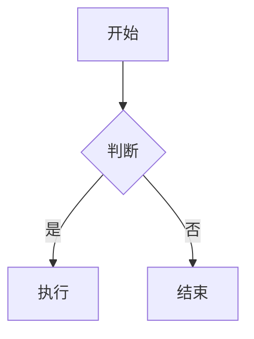
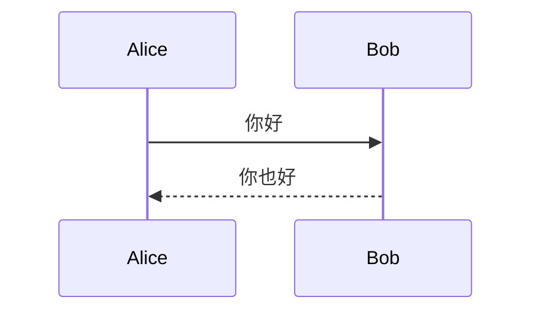
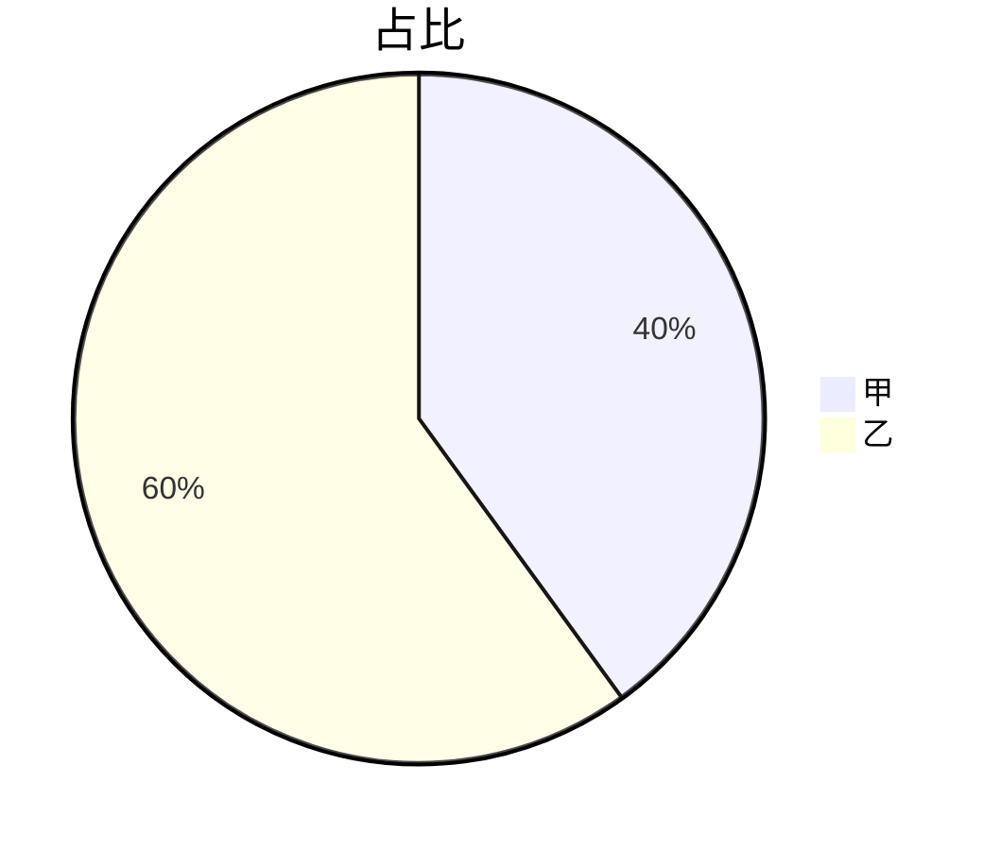

# mermaid 测试夹具

普通段落，确认渲染管线正常。



## 时序图



## 饼图



## 没有 mermaid 的代码块（不应受影响）

```js
const a = 1;
console.log(a);
```

## 错误图表（测错误卡片）

```mermaid
graph TD
  A[ --> B
```

## 一个普通公式

$$E = mc^2$$
